<p align="center">
  
</p>

<h1 align="center">MK</h1>

<p align="center">
  <b>Write it like a script. Ship it as TypeScript.</b><br>
  A full-stack language with reactive signals, a built-in database, HTTP routes and UI components,<br>
  where <code>async</code>/<code>await</code> and ownership are handled by the compiler.
</p>

<p align="center">
  <a href="https://github.com/maksimkrulj/mkcode/actions/workflows/ci.yml"></a>
  <a href="LICENSE"></a>
  
  
  <a href="https://maksimkrulj.github.io/mkcode/"></a>
  <a href="CONTRIBUTING.md"></a>
</p>

<p align="center">
  <a href="https://maksimkrulj.github.io/mkcode/"><b>▶ Try it in your browser</b></a> ·
  <a href="#quick-start">Quick start</a> ·
  <a href="#the-language">Language tour</a> ·
  <a href="#how-it-works">How it works</a> ·
  <a href="docs/MK-Language-Paper.docx">📄 Paper</a> ·
  <a href="#roadmap">Roadmap</a>
</p>

<p align="center">
  
</p>

## A backend in one file

```rust
model Todo { id: int, title: string, done: bool }

route GET "/todos" -> List<Todo> {
    return query Todo order by id
}

route POST "/todos" (title: string) -> Todo {
    return insert Todo { title, done: false }
}

route PATCH "/todos/:todoId" (todoId: int, isDone: bool) -> int {
    return update Todo set done = isDone where id == todoId
}
```

```bash
mk serve todo.mk --watch          # HTTP server on :3000, restarts when you save
mk db migrate todo.mk --db app.sqlite
```

You don't write an ORM, a router, request validation or `async`/`await`. Parameters are checked and
converted for you, so `/todos/abc` gets a `400` with a clear message. A `null` result becomes a
`404`, and an `Err(...)` becomes a `400`.

## Why MK?

| | |
| --- | --- |
| ⚡ **No `async`/`await`** | The compiler finds every function that does I/O (directly or through a call) and makes it `async`, adding `await` only where needed. `list \|> map(fetchUser)` even runs the calls concurrently. |
| 🔁 **Reactivity in the syntax** | `signal`, derived signals and `effect { }` are part of the language. A `live query` is a signal that re-runs whenever its inputs or its table change. |
| 🗄️ **The database is part of the language** | `query`, `insert`, `update` and `delete` compile to SQL with bound parameters and are checked against your `model` schema. Storage is in memory or SQLite (no dependencies), and `mk db migrate` updates the schema. |
| 🌐 **Full stack in one file** | `route GET "/x"` declares HTTP endpoints. `view` components with `<markup>` update in place in the browser and render to HTML on the server. |
| 🧩 **Enums and `match`** | Tagged unions, nested patterns, guards and **exhaustiveness checking**. `Result<T, E>` with `?` replaces exceptions. |
| 🔒 **Ownership checked before you run** | `consume` moves a value. Using it afterwards, on any path, is a compile error. |
| ✅ **Tests built in** | `test "..." { assert a == b }` blocks run with `mk test`, each against a fresh database. Failures show the left and right values. |
| 🛠️ **Real tooling** | A language server (live errors, hover types, go to definition), VS Code highlighting, URL imports with hash-checked caching, and a browser playground. |

## Error messages are part of the design

```text
error[MK3703]: non-exhaustive match: Empty not fully handled
 --> shapes.mk:8:12
  |
8 |     return match s {
  |            ^^^^^^^^^
  = note: add the missing arms, or a '_ => ...' arm to handle the rest

error[MK3001]: use of consumed variable 'buf'
  --> examples/errors/ownership.mk:13:11
   |
13 |     print(buf.length)           // MK3001: use after consume
   |           ^^^
   = note: 'buf' was consumed here and can no longer be used (12:10)
```

Every error has a stable code, the exact line and column, a note pointing at the related place,
and a suggested fix when one is clear. The compiler also catches classic mistakes. For example, it
warns about `where id == id`, which compares the column with itself because a column name always
wins over a variable inside a query.

## Quick start

```bash
git clone https://github.com/maksimkrulj/mkcode.git
cd mkcode
npm install
npm run build
npm link                  # puts `mk` on your PATH
mk run example.mk --seed examples/users.seed.json
```

To skip installing anything, open the **[playground](https://maksimkrulj.github.io/mkcode/)**. It
compiles as you type, runs programs, renders views in a **Preview** tab, runs tests, and gives you
a share link.

| Command | What it does |
| --- | --- |
| `mk run app.mk` | Compile the file and its imports, then run it (`--runtime bun` to use Bun) |
| `mk serve app.mk --watch` | Run it, serve its routes on `--port` (default 3000), and restart on every save |
| `mk test [file \| dir]` | Run `test` blocks, each with a fresh database (`--filter text` to pick some) |
| `mk build app.mk -o out` | Write TypeScript (or `--target js`), keeping the source folder layout |
| `mk check app.mk` | Run the type, ownership and exhaustiveness checks only |
| `mk db migrate app.mk --db app.sqlite` | Create or alter tables to match your models (`--dry-run`, `--allow-drop`) |
| `mk lsp` | Start the language server (used by the VS Code extension) |
| `mk ast` · `mk tokens` | Print the syntax tree or the token stream |

## The language

### Implicit async and concurrent pipelines

```rust
fn fetchScore(name: string) -> int {
    sleep(200)                          // I/O, so fetchScore becomes async
    return len(name) * 10
}

fn main() {
    let scores = ["ana", "marko", "mila"] |> map(fetchScore)   // all three run at once: ~200ms
    print(scores |> filter(fn(s) => s > 30) |> sum)
    let task = spawn fetchScore("late")                        // runs in the background
    print(join(task))
}
```

The compiler builds a call graph and marks a function async if it does I/O itself or calls
something that does. That information also reaches functions you pass to `map`, `filter`, `each`,
`reduce`, `find`, `some`, `every` and `sortBy`:

- `map` and `filter` run I/O callbacks **concurrently**.
- The others keep going in order.

`a |> f(b)` is just `f(a, b)`, so pipelines read left to right.

### Signals, effects and live queries

```rust
model Player { id: int, name: string, score: int }

signal minScore = 50
signal leaders = live query Player where score >= minScore order by score desc

effect { print("🏆", leaders |> map(fn(p) => p.name)) }

fn main() {
    insert Player { name: "Ana", score: 92 }    // the effect prints [Ana]
    minScore = 30                               // the query re-runs
}
```

Derived signals are computed lazily and cached. A `live query` re-runs when a signal used in its
`where` changes, and after every write to its table. Writes wait for the live queries that depend
on them, so the code right after an `insert` already sees fresh data.

### Enums, `match` and `Result`

```rust
enum Shape {
    Circle(radius: float)
    Rect(w: float, h: float)
    Empty
}

fn describe(s: Shape) -> string {
    return match s {
        Circle(r) if r > 10.0 => "a big circle"
        Circle(_) => "a circle"
        Rect(w, h) if w == h => "a square"
        Rect(_, _) => "a rectangle"
        Empty => "nothing"
    }
}

fn nextBirthday(text: string) -> Result<int, ParseError> {
    let age = parseAge(text)?        // returns the Err early, otherwise unwraps Ok
    return Ok(age + 1)
}
```

`match` checks that every case is handled, including nested patterns such as
`Err(Negative(v))`. It compiles to plain `if` chains on a `tag` field. `?` compiles to an early
`return`. After `if user == null { return ... }`, the compiler knows `user` is not null.

### Views: UI components

```rust
view Counter(start: int = 0) {
    signal count = start
    <div class="card">
        <h2>Clicked {count} times</h2>
        <button on:click={count += 1}>+1</button>
        {count >= 5 && <p>🔥 You're on fire!</p>}
    </div>
}

view Greeter() {
    signal name = "world"
    <input bind:value={name} />
}

mount(<Counter start={0} />)
```

- **In the browser**, every `{expression}` becomes a small effect. A click updates only the text
  that depends on `count`. There is no virtual DOM and no diffing.
- **On the server**, the same view renders to HTML: `route GET "/" -> Markup { return <Page /> }`.
- The compiler checks props: unknown or missing props are errors, and so is I/O inside markup.
- Try it in the playground's **Preview** tab.

### Database

```rust
let top   = query User where score >= min && name.startsWith("A") order by score desc limit 10
let one   = query first User where id == userId           // User?
let n     = query count User where email == null          // int, compiled to IS NULL
let row   = insert User { name: "Ana", score: 92 }
let bumps = update User set score = score + 5 where score < 70
let gone  = delete User where email == null
```

Values always become bound parameters, so SQL injection isn't possible through a query. Unknown
columns, wrong types and missing insert fields are compile errors.

There are three storage backends:

- **In memory** (the default).
- **SQLite** through Node's built-in `node:sqlite` (`--db app.sqlite`).
- **Your own database**: `db.use(new SqlAdapter("postgres", driver))`.

A test runs the same set of queries on both the in-memory and SQLite backends and checks that the
results match.

### Tests

```rust
test "deposit rejects negative amounts" {
    assert deposit(1, -5) == Err("amount must be positive")
}

test "the API validates input" {
    assert request("POST", "/todos", {}).status == 400
}
```

`request(method, path, body)` calls your routes in-process, so API tests need no server.

### Ownership with `consume`

| Code | Rule |
| --- | --- |
| MK3001 | A variable is used after it was consumed, in the same block or a nested one |
| MK3002 | A variable is used after a branch that might have consumed it |
| MK3006 / MK3007 | A variable is consumed inside a closure, or consumed while a closure still uses it |
| MK3008 | A borrowed parameter is consumed (declare it `consume p: T` instead) |
| MK3009 | A variable from outside a loop is consumed inside the loop |
| MK3010 | A variable is passed to a `consume` parameter without writing `consume` |

`consume` has no runtime cost: it compiles to nothing.

### URL imports

```rust
import { nanoid } from "https://cdn.jsdelivr.net/npm/nanoid@5.0.9/index.browser.js"
import { triple } from "https://example.com/lib/math.mk"
```

Each download is cached and recorded with its SHA-256 hash in `.mk_cache/manifest.json`. Later
runs work offline, and a cached file that was changed is rejected.

## How it works

```
.mk ─▶ Lexer ─▶ Parser ─▶ Analyzer ──────────────────────────▶ CodeGenerator ─▶ .ts / .mjs
        │         │          ├ scopes, gradual types, null narrowing  ├ readable TS, comments kept
     tokens,   AST with      ├ ownership tracked on every path        ├ async/await placed exactly
     markup    error         ├ async fixpoint over the call graph     ├ match → if chains, ? → return
               recovery      ├ exhaustiveness of match                └ query builders, h(), routes
                             └ query column vs. value analysis
```

| Path | Role |
| --- | --- |
| `src/lexer/` | Tokens, markup scanning (JSX-style, decided by the previous token), string interpolation |
| `src/parser/` | Recursive-descent parser with contextual keywords. Reports errors with line and column, then recovers and keeps going. |
| `src/analyzer/` | Symbols, gradual types, ownership, async inference, pattern exhaustiveness, query and route checks |
| `src/codegen/` | AST → TypeScript or JavaScript. `match` and `?` are lowered into plain statements before the statement that uses them. |
| `src/runtime/` | `$mk` runtime with no dependencies: signals, live queries, SQL compiler and adapters, HTTP router, DOM/HTML renderer, test runner |
| `src/cli/` | `mk` commands, multi-module builds, URL cache, language server |
| `playground/` | The browser playground, running the real compiler from `dist/` |
| `editors/vscode/` | VS Code extension: highlighting plus a client for `mk lsp` |

All 125 tests run in CI on Linux, macOS and Windows, with Node 22 and 24. They include running the
generated TypeScript of every example through `tsc --strict`, real HTTP requests against
`mk serve`, and a language-server session over stdio.

## Editor support

**VS Code**: [`editors/vscode`](editors/vscode) provides syntax highlighting (including markup,
`match` and `|>`) and starts `mk lsp`. That gives you errors as you type, hover with inferred types
(including "this function performs I/O and was compiled as async"), go to definition, the document
outline and completion.

## The paper

**[MK: A Reactive, Database-Native Language with Implicit Asynchrony and Compile-Time Ownership](docs/MK-Language-Paper.docx)**
(30 pages, .docx) covers MK in depth. Its parts are:

- **Section 2** teaches programming fundamentals through MK, for complete beginners.
- **Section 3** presents each feature as a problem, the existing approaches and MK's solution.
- **Section 4** explains the compiler's analyses: ownership as dataflow, asynchrony as a least fixed
  point, and exhaustiveness checking.
- **Sections 5–6** cover the evaluation and related work.
- **Appendices** contain the full grammar, the diagnostic codes and the exercise solutions.

## Roadmap

- [x] Lexer, parser, analyzer, code generator, CLI
- [x] Signals, live queries, database, ownership, implicit async, URL imports
- [x] Enums, `match`, `Result`, `?`, null narrowing
- [x] Routes and `mk serve`, views and markup, `mk test`, `mk db migrate`
- [x] Language server, VS Code extension, browser playground
- [ ] Hydration: server-rendered views that become interactive in the browser
- [ ] Postgres adapter out of the box
- [ ] Moving individual fields with `consume`
- [ ] Generics in user code (`fn first<T>(xs: List<T>) -> T?`)
- [ ] Publish to npm, so `npx mkcode run app.mk` works

Want to build one of these? See **[CONTRIBUTING.md](CONTRIBUTING.md)**. Every stage of the
compiler is small and has its own tests.

## Known limitations

- An async lambda passed to a host *method* such as `list.map(...)` gives you back a list of
  promises. Use the built-in `list |> map(...)` instead, which knows about I/O.
- A signal assignment that triggers a live query doesn't wait for the query to re-run. Writes to
  the database do wait.
- `match` and `?` can't appear on the right side of `&&`, `||` or `??`, or in a `while` condition.
  Store the result in a variable first.
- In `select a, b` and `order by a, b`, the commas are read greedily. When you pass such a query as
  an argument, wrap it in parentheses.

---

<p align="center">
  If MK made you think <i>"why isn't TypeScript like this?"</i>, consider giving it a ⭐<br>
  It helps other people find the project.
</p>

<p align="center">
  <a href="https://star-history.com/#maksimkrulj/mkcode&Date">
    
  </a>
</p>

<p align="center"><sub>MIT © maksimkrulj</sub></p>
